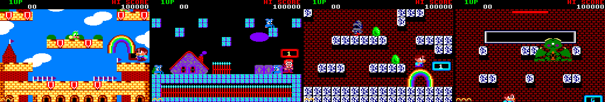

# Rainbow Islands — le remake CPC en PHP



La version **Amstrad CPC** de *Rainbow Islands* (Graftgold / Ocean, 1989), réécrite en PHP et jouable
**dans le navigateur** comme **sur le bureau**. Les graphismes, les cartes, la police, l'écran de chargement,
les musiques et les bruitages sont ceux de la disquette d'origine : ils en ont été extraits avec un émulateur
CPC, sans rien redessiner.

**▶ Pour jouer : le lien *Website* en haut de la page du dépôt GitHub.**

## Le jeu

Bub grimpe jusqu'au panneau **G** en haut de chaque round avant que la mer ne le rattrape. Ses
arcs-en-ciel assomment les ennemis (qui deviennent des fruits), servent de passerelles, et se cassent quand
on retombe dessus après un saut : ils tombent alors et changent les ennemis écrasés en diamants.

- 7 îles et 28 rounds, un boss au bout de chaque île ;
- l'alerte *HURRY!* et la montée des eaux, l'écran de continue, la fin du jeu ;
- meilleur score et options (volume, langue, plein écran) sauvegardés.

| | Clavier | Manette | Téléphone |
|---|---|---|---|
| Marcher | ← → | stick ou croix | joystick sous le pouce gauche |
| Sauter | ↑ ou Z | A | bouton JUMP |
| Arc-en-ciel | Espace ou X | X ou B | bouton RAINBOW |
| Pause | P ou Échap | Start | |

## Le code

Le jeu est écrit avec [JumPHP](https://github.com/davidnurdin/jumPhp), un moteur de jeux rétro en PHP : le
même code tourne dans une fenêtre (PHP 8.3 + SDL2) et dans le navigateur (PHP compilé en WebAssembly).

```
games/rainbow-island/
  src/Scene/       écrans : chargement, titre, options, partie, pause, game over, fin
  src/Entity/      Bub, les arcs-en-ciel, les ennemis, les objets, les boss
  src/World/       les îles, les rounds (cartes), le terrain sur lequel on marche
  src/Game/        la partie en cours (score, vies, round), le tableau des scores
  src/Arcade/      les images, les sons et la police d'origine
  assets/          ce qui vient de la disquette : cartes JSON, tuiles, sprites, musiques Ogg
  site/            le site (page d'accueil, images) ; le jeu est servi dans /play/
  tools/extract/   comment les assets ont été extraits (adresses, scripts)
  tools/site/      les captures et les images du site
engine/            le moteur JumPHP ; bin/jumphp la ligne de commande
```

Tout passe par Docker, avec `bin/jumphp` : rien à installer d'autre.

```bash
bin/jumphp install rainbow-island    # dépendances
bin/jumphp run rainbow-island        # jouer sur le bureau (fenêtre + son)
bin/jumphp test rainbow-island       # vérifications + 600 images de démo sans écran
bin/jumphp engine:download           # le moteur WebAssembly (une fois)
bin/jumphp build rainbow-island      # version navigateur -> games/rainbow-island/dist/web
bin/jumphp serve rainbow-island      # http://localhost:8080
bin/jumphp deploy                    # le site + le jeu sur le serveur (.env)
```

Les notes techniques (scènes, physique, ce qui n'est pas évident) sont dans
[games/rainbow-island/README.md](games/rainbow-island/README.md) et
[games/rainbow-island/AGENTS.md](games/rainbow-island/AGENTS.md). Le fonctionnement du moteur est dans
[AGENTS.md](AGENTS.md) et [docs/](docs/).

## D'où viennent les graphismes et la musique

La disquette a tourné dans l'émulateur CPC sans écran de
[dsk2jumphp](https://github.com/davidnurdin/dsk2jumphp), qui note chaque écriture en mémoire et chaque
registre du processeur sonore. Les tuiles, les sprites, la police et les palettes ont été lus dans la
mémoire, les cartes des 28 rounds rebâties à partir des écritures pendant le défilement, et la musique
rejouée depuis le journal du processeur sonore. Les adresses trouvées et les scripts sont dans
[games/rainbow-island/tools/extract/](games/rainbow-island/tools/extract/) ; l'extraction complète refait
`assets/` à l'identique depuis la disquette (qui n'est pas dans le dépôt).

## Mettre à jour le moteur

```bash
bin/jumphp update    # fusionne la dernière version de JumPHP (remote git `jumphp`)
```

Les jeux d'exemple de JumPHP (pong, jumpball...) ont été retirés de ce dépôt : si une mise à jour les
ramène en conflit, `git rm -r games/<jeu>` le règle.

## Licence

Le code (le moteur et le jeu) est sous licence MIT. *Rainbow Islands* © Taito Corporation 1987 ; la version
Amstrad CPC © Graftgold 1989, éditée par Ocean. Les graphismes, la musique et les bruitages appartiennent à
leurs auteurs ; ce remake de fan n'est affilié à aucune de ces sociétés.
