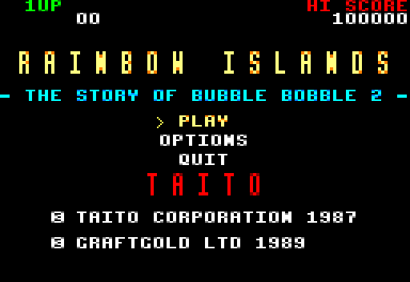

# rainbow-island

Le remake de *Rainbow Islands* version Amstrad CPC (Graftgold, 1989) avec JumPHP. Présentation du projet :
le [README du dépôt](../../README.md).



## Commandes (depuis la racine du dépôt)

```bash
bin/jumphp install rainbow-island   # dépendances
bin/jumphp run rainbow-island       # jouer sur le bureau
bin/jumphp test rainbow-island      # php -l, phpstan, démo de 600 images sans écran
bin/jumphp build rainbow-island     # version navigateur -> dist/web
bin/jumphp serve rainbow-island     # http://localhost:8080
bin/jumphp deploy                   # site/ à la racine du domaine, le jeu dans /play/
```

Pour essayer un round ou un boss directement :

```bash
JUMPHP_SCENE='App\Scene\PlayScene' JUMPHP_SCENE_PARAMS='{"round":13}' bin/jumphp shot rainbow-island 200
JUMPHP_SCENE='App\Scene\PlayScene' JUMPHP_SCENE_PARAMS='{"round":28,"arena":true}' bin/jumphp shot rainbow-island 200
```

`round` va de 1 à 28, `arena` démarre au panneau G (devant le boss au 4e round d'une île), `demo` fait jouer
un robot.

## Comment c'est fait

| Dossier | |
|---|---|
| `src/Scene/` | `LoadingScene` (l'écran de chargement d'origine) → `TitleScene` → `PlayScene` → `EndingScene` ; par-dessus : `PauseScene`, `GameOverScene` (continue), `OptionsScene` |
| `src/Entity/` | `Bub`, `Rainbow`, `Enemy` (marcheurs et volants), `Item` (fruits, diamants, bonus), `Boss` |
| `src/World/` | `Island` (palette, ennemis, boss), `Round` (la carte : 32 colonnes de tuiles de 8 px), `Terrain` (où l'on peut se tenir : dessus des tuiles pleines, traversées par-dessous, et les arcs-en-ciel) |
| `src/Game/` | `Session` (score, vies, round, diamants, meilleur score sauvegardé), `ScoreBoard` |
| `src/Arcade/` | `Artwork` (textures et sons), `ArcadeFont` (la police du CPC, 5 couleurs) |
| `assets/` | extraits de la disquette : 28 cartes JSON, tuiles et sprites des 7 îles, police, écran de chargement, musiques et bruitages Ogg |
| `site/` | le site : `index.html` (SEO, données structurées), `images/`, `robots.txt`, `sitemap.xml` (`{{DOMAIN}}` remplacé au déploiement) |
| `tools/extract/` | l'extraction des assets depuis la disquette (adresses mémoire, scripts) |
| `tools/site/` | `shots.sh` refait les captures et les images du site (`make-images.py`, à partir des vraies tuiles) |

L'écran fait 256 × 176 comme sur le CPC (128 pixels du mode 0, dessinés deux fois plus larges) : 16 lignes
de scores et 160 lignes de jeu. Les vitesses et les délais viennent de l'original (observés dans
l'émulateur, qui tourne à 50 images par seconde).

## L'extraction

Les assets ont été sortis de la disquette avec
[dsk2jumphp](https://github.com/davidnurdin/dsk2jumphp) (un émulateur CPC sans écran qui note tout ce que fait
le jeu). `tools/extract/README.md` donne les adresses trouvées et la commande qui refait `assets/` à partir
de votre propre `rainbow.dsk` (la disquette n'est pas dans le dépôt).

Ce qui reste incertain : certains types d'ennemis (déduits de l'ordre des images), et les boss des îles 2 à
6, dessinés ici avec le plus grand sprite de l'île en double taille.
